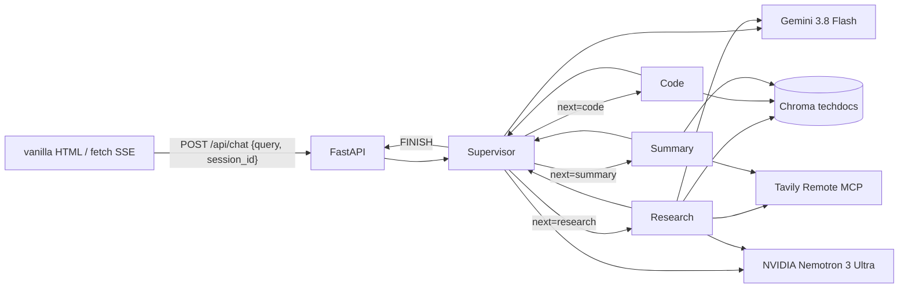

# CSCI 599 Assignment 2 — Multi-Agent RAG

Supervisor-orchestrated LangGraph system: three specialized agents (research, code, summary) retrieve from a Chroma index of LangGraph / LangChain / FastAPI docs, share Tavily Remote MCP for live web knowledge, and route generation across **Google Gemini** and **NVIDIA NIM**. FastAPI streams tokens, traces, and citations over SSE to a single vanilla HTML page.

**Live URL:** https://multi-agent-rag-881242810047.us-west1.run.app

Assignment 1 is a different Cloud Run service in the same project and was not changed: https://csci599-a1-4mbqu4lsoa-uw.a.run.app

Expect the first request after idle to take several seconds (Cloud Run cold start). A docs question is usually 15–50 s. A live-web question (Tavily) is longer. The right-hand panel shows which agent ran, which provider, and why. If Gemini 429s or times out, the trace shows `dimension=fallback` and NVIDIA continues.

## Architecture



Routing is hybrid cost/capability. Supervisor and short lookups go to Gemini; multi-step synthesis and any Gemini failure go to NVIDIA. Research and summary both call the **same** Tavily MCP server (criterion 6, MCP tool sharing). See `docs/architecture.md`.

## Prerequisites

- Python 3.13 or 3.14
- `GOOGLE_API_KEY` from [Google AI Studio](https://aistudio.google.com/apikey) (free tier; Flash is 20 requests/day)
- `NVIDIA_API_KEY` from [build.nvidia.com](https://build.nvidia.com)
- `TAVILY_API_KEY` from [tavily.com](https://tavily.com) (student/free plan)

Embeddings are local (`fastembed` / `BAAI/bge-small-en-v1.5`). NVIDIA hosted embeddings on this account are retired.

## Local development

```bash
cd /Users/samarth_raj/Agentic_Assignment_2
python3 -m venv .venv
.venv/bin/pip install -r requirements.txt
cp .env.example .env   # fill the three keys; quote values
chmod +x scripts/fetch_corpus.sh
./scripts/fetch_corpus.sh
.venv/bin/python -m src.rag.ingest
.venv/bin/python main.py
```

Open http://127.0.0.1:8080. Quote `.env` values (`GOOGLE_API_KEY="..."`). A leading space after `=` makes `deploy.sh` treat the key as a command.

```bash
.venv/bin/pytest -q
.venv/bin/python -m src.eval.ragas_eval
```

## Deploy

Same GCP project as Assignment 1 (`csci-599-agenticai`), **different** service (`multi-agent-rag`). Do not run Assignment 1’s `deploy.sh`.

```bash
cd /Users/samarth_raj/Agentic_Assignment_2
export GCP_PROJECT_ID=csci-599-agenticai
export GCP_REGION=us-west1
export CLOUD_RUN_SERVICE=multi-agent-rag
./deploy.sh
```

`.gcloudignore` (not `.gitignore`) controls the upload so `chroma_index/` is included and `.env` is not. Image: Python 3.13-slim, non-root, 1 GiB, 300 s timeout, concurrency 10, max 3 instances.

This deploy does **not** claim durable multi-turn memory across instance recycling. SQLite under `/tmp` is not durable. Use Firestore or GCS/GCSFuse before advertising that.

## Cost of each run

Pricing checked 2026-10-26. Embeddings are local ($0). Tavily is the student/free plan. Cloud Run is on the USC education credit (1 GiB, min-instances=0). Gemini Flash input/output is free on the free tier until the **20 requests/day** cap; paid list price is $0.75 / $3.75 per 1M tokens through 2026-12-31. NVIDIA NIM is the student/free provider.

| Run | What happens | Gemini | NVIDIA | Tavily | Embed / Cloud Run | Typical wall |
|---|---|---|---|---|---|---|
| `GET /` or `/health` | static + inventory | 0 | 0 | 0 | credit, 0.3–3 s | < 3 s |
| Docs lookup (“what is a checkpointer?”) | supervisor → research → `search_docs` ×1–3 → answer | 2 short calls (or 429) | 0, or 1–2 if fallback | 0 | $0 + credit | 15–50 s |
| Live web (“what’s OpenClaw?”) | supervisor → research → `tavily_search` → answer | 1–2, or timeout/503 | 1 generation if Gemini dies | 1 search | $0 + credit | 40–80 s after fix |
| Code (“write a FastAPI SSE endpoint”) | supervisor → code → `search_code_examples` + `check_python` | 1–2 | 1 if complexity ≥ 2 | 0 | $0 + credit | 20–60 s |
| Summary (“summarize persistence.mdx”) | supervisor → summary → `fetch_document` | summary on Flash | fallback only | 0 unless URL | $0 + credit | 20–60 s |
| Broken OpenClaw turn (2026-10-26, before fix) | Gemini 503 + 120 s Gemini timeout + NVIDIA + Tavily | 2 failures | 2 chat calls | 1 search | credit ~2.5 min | **146 s**, empty UI |

A “run” is one `POST /api/chat`. The supervisor always spends one classification call. Each worker spends one generation plus its tools. Failover doubles the LLM calls for that hop.

## Latency (measured)

| Path | TTFT | Total |
|---|---|---|
| Warm `/health` | — | 0.27 s |
| `/health` after idle | — | 2.86 s |
| Warm RAG, NVIDIA fallback (checkpointer) | 4.5 s | 48.7 s |
| OpenClaw before UI/timeout fix | none shown | ~146 s |

Full tables: `docs/evaluation.md`. Narrative: `PROCESS_LOG.md`.

## Tests

```bash
.venv/bin/pytest -q
```
