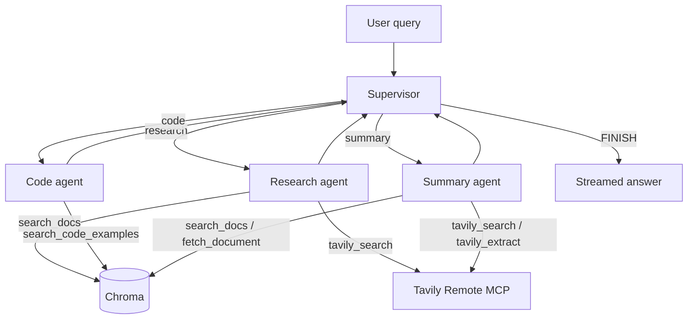

# Architecture

## Orchestration

Supervisor pattern. The supervisor is a structured-output node (not counted as one of the three specialized agents). Workers return to the supervisor; the supervisor either dispatches another worker or finishes.

Hop cap: `MAX_SUPERVISOR_HOPS` (default 3). A failed worker writes an error message into state and returns; the graph does not crash.

### State schema

| Field | Type | Role |
|---|---|---|
| `messages` | list of LangChain messages | conversation; reducer `add_messages` |
| `next` | `research` / `code` / `summary` / `FINISH` | supervisor routing field |
| `reason` | str | inspectable routing rationale |
| `hops` | int | hop counter this turn |
| `turn` | list of `{agent, ok, provider, msg_id}` | workers already run |
| `citations` | list of citation dicts | accumulated RAG artifacts |

Thread id = `session_id`. Local: `AsyncSqliteSaver`. Cloud Run durable path (when claimed): Firestore.

## Agents

| Agent | Unique tools | Unique prompt focus |
|---|---|---|
| research | `search_docs`, Tavily `tavily_search` | grounded factual answers; docs first, live web for current events |
| code | `search_code_examples`, `check_python` | generate / review Python against documented APIs |
| summary | `search_docs`, `fetch_document`, Tavily `tavily_search` + `tavily_extract` | structured summaries that keep citation ids |

MCP tool sharing: research and summary both invoke the same Tavily Remote MCP server. Each call is wrapped so the trace records `{server, tool, agent}`.

## LLM routing

Dimension: hybrid cost + capability. Two providers, not two models of one provider.

| Role / condition | Provider | Model | Why |
|---|---|---|---|
| supervisor | Gemini | `gemini-3.8-flash` | short classification |
| summary | Gemini | `gemini-3.8-flash` | long context, low cost |
| research / code, complexity < 2 | Gemini | `gemini-3.8-flash` | cheap lookup |
| research / code, complexity ≥ 2 | NVIDIA | `nvidia/nemotron-3-ultra-550b-a55b` | multi-step synthesis |
| any call whose provider has no key or raised | the other provider | (same table) | fallback, labeled `dimension=fallback` |

Complexity counts compare/versus/why/implement-style cues, extra question marks, and queries longer than 30 words. Every decision is an `llm_route` SSE event: `{agent, provider, model, dimension, reason}`.

## RAG pipeline

| Stage | Choice |
|---|---|
| Corpus | LangGraph + LangChain + FastAPI public docs. `scripts/fetch_corpus.sh` records commit SHAs in `corpus/SOURCES.txt`. ~270 pages, ~4.6k chunks. |
| Chunking | Markdown headers (`#` / `##` / `###`), then `RecursiveCharacterTextSplitter(1200, overlap=150)`. IDs = `sha1(source#index)[:16]`. |
| Embeddings | local `fastembed` `BAAI/bge-small-en-v1.5` (384-d). NVIDIA hosted embeddings are retired on this account. |
| Store | embedded Chroma, cosine HNSW, collection `techdocs`. Baked into the container. |
| Retrieval `k` | 5. Code agent filters `has_code=True`. |
| Augmentation | retrieved chunks injected as `[source#chunk] title — section` blocks. The system prompt requires those ids in the answer. |
| Generation | worker LLM (routed as above). |

## Durable state

Not claimed yet. Local and the first Cloud Run deploy use SQLite. `/tmp/state.sqlite` on Cloud Run does **not** survive instance replacement. Switch to Firestore (or GCS/GCSFuse) before advertising multi-turn memory across restarts.
